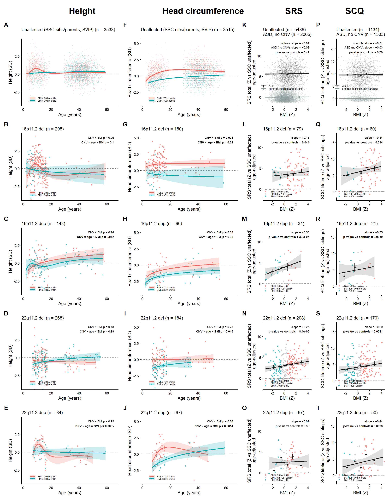
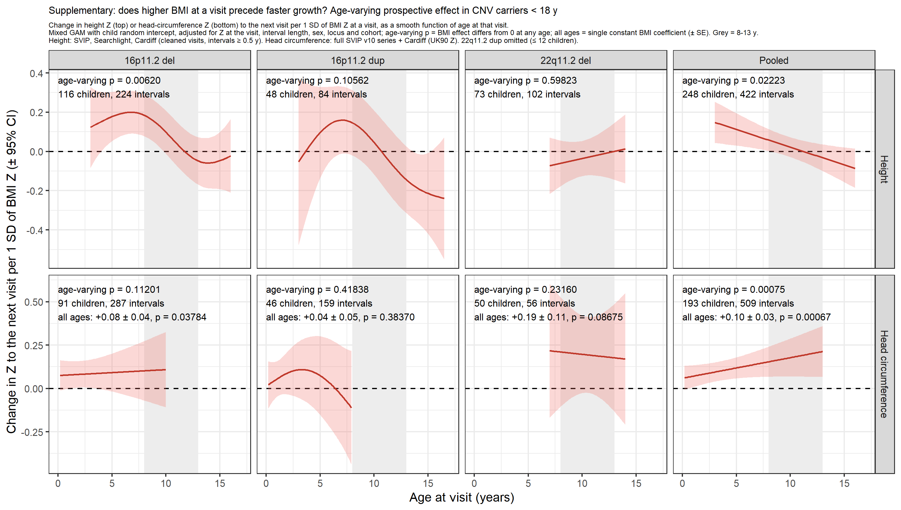
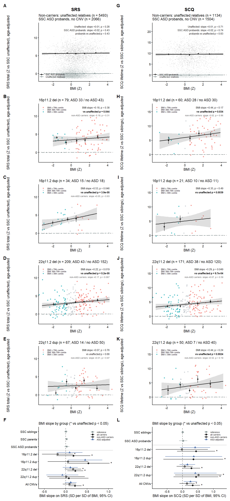
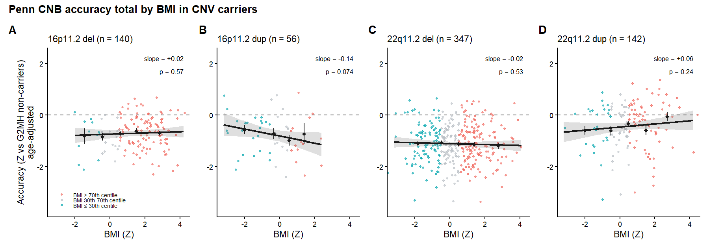
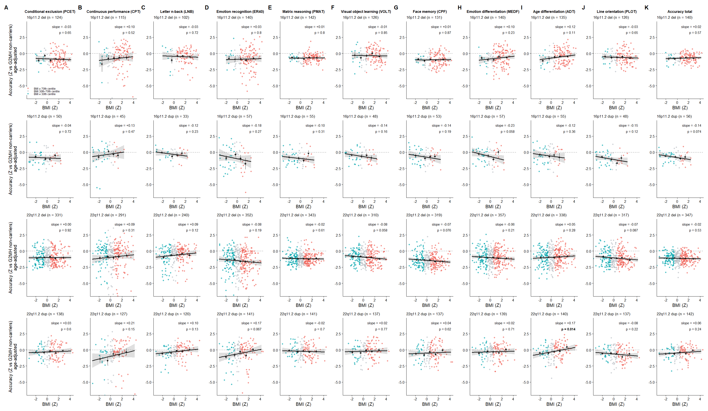
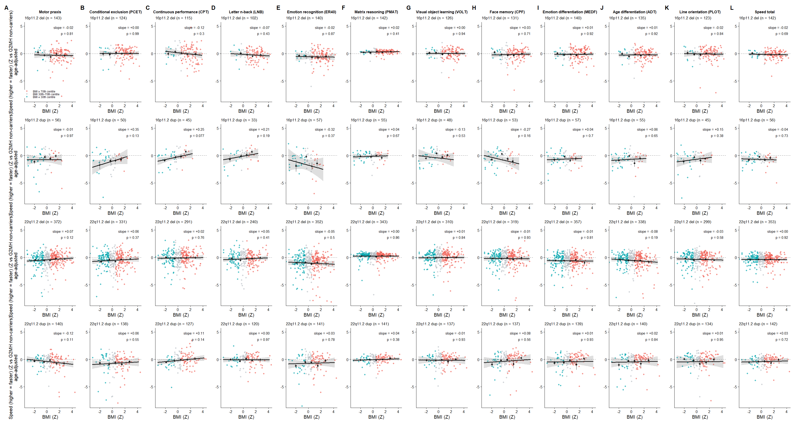
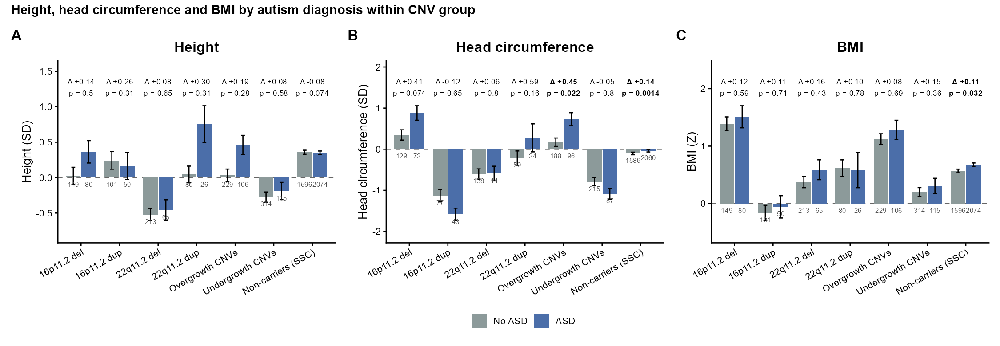

# Body mass, growth and social-communication phenotypes in carriers of 16p11.2 and 22q11.2 CNVs: manuscript sections

Draft sections for insertion into the Nature Genetics manuscript, prepared 2026-10-26 (J. Sebat; analysis with Claude). Part 1, main text (target ~700 words) and the Figure 1 legend; Part 2, Methods for the main figure; Part 3, Supplementary Information (Supplementary Results, Supplementary Methods, Supplementary Figs. 1-5, Supplementary Tables 1-9). References are numbered in order of first citation and given with PubMed IDs. All numbers are provisional until the corrected growth records and new participants are added (see HANDOFF_2026-10-26.md); figure panel letters will be converted to lower case in the final artwork. Items marked [to confirm] need author input.

# Part 1. Main text

## Body mass is coupled to head growth and social-communication impairment in CNV carriers

Recurrent copy-number variants (CNVs) at 16p11.2 and 22q11.2 have reciprocal effects on body mass and head size: 16p11.2 deletion carriers are prone to obesity and macrocephaly and duplication carriers to underweight and microcephaly^1-3^, and 22q11.2 deletion is associated with obesity in adulthood^4^. Whether body mass is itself coupled to growth and to the neurodevelopmental phenotype of carriers is not known. We therefore asked whether, within carriers, body mass index (BMI) is associated with height, head circumference and social-communication traits beyond the relationships seen in the general population.

We analysed carriers of 16p11.2 (BP4-BP5) and 22q11.2 (A-D) deletions and duplications from the G2MH, Simons VIP, Simons Searchlight and Cardiff cohorts (*n* = 118-358 per CNV), unaffected non-carrier relatives from the Simons Simplex Collection (SSC)^5^ and Simons VIP^6^ (*n* = 5,708) and autistic SSC probands without a CNV (*n* = 2,074). Height, head circumference and BMI were expressed as age- and sex-standardized *z* scores^7-9^ and modelled with generalized additive models (GAMs) in which the BMI effect within each group is an age-adjusted slope (s.d. of outcome per s.d. of BMI) and the carrier-control contrast (CNV x BMI) is the age-adjusted difference in that slope (Fig. 1, Supplementary Tables 1 and 2).

Height in carriers differed from controls by a constant shift (up to -0.70 s.d. in 16p11.2 deletion), but the relationship between BMI and height was the same as in controls for every CNV (CNV x BMI, *P* = 0.24-0.99; Fig. 1a-e). Head circumference rose with BMI in every group, including controls (+0.36 s.d. per s.d.), and 16p11.2 deletion carriers showed an excess over this general relationship (+0.13 s.d. per s.d., s.e. 0.06, *P* = 0.021; Fig. 1g). No other CNV did (*P* = 0.39-0.73; heterogeneity across CNVs *P* = 0.21), and the excess was also present relative to autistic SSC probands (+0.17, *P* = 0.002). In longitudinal series from children, higher BMI at a visit preceded faster head growth to the next visit (pooled carriers +0.10 s.d. per s.d., *P* = 6.7 x 10^-4^), whereas a prospective effect on height growth was confined to children under 8 years (Supplementary Fig. 1, Supplementary Table 3). Within the overgrowth CNVs (16p11.2 deletion and 22q11.2 duplication), carriers with autism had larger heads than carriers without (+0.45 s.d., *P* = 0.022; *P* = 0.046 versus the proband-sibling difference in the SSC), but BMI did not differ by autism status in any CNV group (Supplementary Fig. 5, Supplementary Tables 7 and 8).

Social-communication impairment also tracked body mass in carriers. Social Responsiveness Scale (SRS)^10^ and Social Communication Questionnaire (SCQ)^11^ scores rose with BMI in carriers of every CNV, with slopes exceeding those of unaffected relatives for SCQ in all four CNVs (CNV x BMI +0.26 to +0.48 s.d. per s.d., *P* <= 0.034) and for SRS in three (+0.17 to +0.50, *P* = 0.044 to 8.4 x 10^-6^; Fig. 1k-t). Pooled across CNVs the excess was +0.21 s.d. per s.d. for SRS (*P* = 1.6 x 10^-6^) and +0.34 for SCQ (*P* = 4.8 x 10^-5^), with no heterogeneity between CNVs (*P* = 0.61 and 0.96). Neither unaffected relatives (+0.01) nor autistic SSC probands without a CNV (+0.03; *P* versus relatives 0.42 and 0.79) showed any BMI slope, so the association is a property of CNV carriers rather than of autism (Supplementary Fig. 2). Cognitive performance (Penn CNB) was unrelated to BMI (Supplementary Figs. 3 and 4).

These associations were not explained by sex, polygenic background, medication or diagnosis. Adjusting the CNV x BMI contrasts for sex and for polygenic scores for childhood obesity, adult BMI, height and autism, singly or together, left the estimates unchanged on the same individuals, and the effects were present within each sex and within both halves of every polygenic-score distribution (Supplementary Tables 4 and 5); no adequately powered modifier x BMI interaction survived correction (Supplementary Table 6). Psychotropic medication (29-33% of carriers) was associated with the traits but not with BMI, and the slopes were unchanged after adjustment for medication class or restriction to unmedicated carriers (Supplementary Table 9). Together, these results show that in carriers of these CNVs body mass is coupled to head growth, specifically in 16p11.2 deletion, and to the severity of social-communication impairment across all four CNVs, in a way that is not seen in the general population or in idiopathic autism.

[Word count of the five paragraphs above: 716.]

**Figure 1 | Body mass, growth and social-communication phenotypes in carriers of 16p11.2 and 22q11.2 CNVs and in unaffected relatives.**

**a-j**, Height *z* score (WHO; **a-e**) and head-circumference *z* score (UK90; **f-j**) against age in unaffected non-carrier relatives (**a**,**f**; SSC designated siblings and parents and Simons VIP non-carrier family members without autism) and in carriers of 16p11.2 deletion (**b**,**g**), 16p11.2 duplication (**c**,**h**), 22q11.2 deletion (**d**,**i**) and 22q11.2 duplication (**e**,**j**), for individuals with BMI at or above the 70th centile (red) or at or below the 30th centile (teal); lines are generalized additive model (GAM) smooths with 95% confidence bands. Printed values in **b-e** and **g-j** are two-sided *P* values from GAMs fitted to all individuals with continuous BMI, not only the plotted tails: CNV x BMI, the age-adjusted difference between carriers and controls in the slope of the outcome on BMI *z*; CNV x age x BMI, whether that difference varies with age (tensor-product interaction). **k-t**, SRS total (*z* relative to SSC unaffected relatives; **k-o**) and SCQ lifetime total (*z* relative to SSC siblings; **p-t**), adjusted for age within group, against BMI *z*; points are coloured by BMI tail as above (grey, 30th-70th centile); black line and band, linear fit with 95% CI; diamonds, mean +/- s.e.m. in BMI bins (< -1, -1 to 0, 0 to 1, 1 to 2, > 2 s.d.); dashed grey line, the fit in unaffected relatives. **k** and **p** also show SSC probands with autism and no CNV (black). Printed values are the within-group BMI slope (s.d. of trait per s.d. of BMI; GAM *y* ~ s(age) + BMI) and the two-sided *P* value for its difference from unaffected relatives (model as in **a-j**). Bold, nominal *P* < 0.05. *n* (controls; 16p11.2 del, 16p11.2 dup, 22q11.2 del, 22q11.2 dup): height 5,708; 358, 199, 357, 118. Head circumference 5,680; 211, 125, 242, 92. SRS 5,486 (probands 2,065); 79, 34, 208, 67. SCQ 1,134 (probands 1,503); 60, 21, 170, 50. Heterogeneity of the age-adjusted BMI slope across the four CNV groups (Wald test of the locus x BMI interaction within carriers): height *P* = 0.75, head circumference *P* = 0.21, SRS *P* = 0.61, SCQ *P* = 0.96. BMI *z*: WHO for children; for adults, centile relative to the pooled non-carrier adults of the clinical cohorts mapped to *z*. Carriers with and without autism are combined. All tests are two-sided; no adjustment for multiple comparisons was applied to the printed *P* values.

# Part 2. Methods (main figure)

**Participants**

Carriers of 16p11.2 proximal (BP4-BP5) deletions and duplications and 22q11.2 (LCR A-D) deletions and duplications were drawn from the Genes to Mental Health (G2MH) network, the Simons Variation in Individuals Project (Simons VIP)^6^, Simons Searchlight and the Cardiff University cohort [to confirm: CNV calling and inclusion criteria per cohort; ethics approvals and consent statement for each site]. Unaffected controls were non-carrier designated siblings and parents from the Simons Simplex Collection (SSC)^5^ and non-carrier family members without autism from Simons VIP. SSC probands with autism and no CNV formed a separate autism comparison group. Analyses used participants aged 2-65 years and, for each individual, the most recent visit at which the outcome and BMI were both available. Autism diagnosis in carriers was taken from the G2MH subject table and the Simons VIP diagnostic summary; all SSC probands carry an autism diagnosis by design. Social-communication measures were the SRS-2 total raw score^10^ (parent report for children, adult self or informant report) and the SCQ lifetime total^11^.

**Anthropometric measures**

Height, weight and head circumference were taken from the clinical and research records of each cohort. Before scoring, implausible values were screened as described in the Supplementary Methods (heights recorded in metres were converted; heights outside 60-230 cm, BMI outside 10-70 kg m^-2^, |height *z*| > 5, child |BMI *z*| > 5 and head circumference outside 30-70 cm or |*z*| > 5 were set to missing). Height was standardized against the WHO child growth standards and the WHO 2007 reference^7,8^; head circumference against the UK 1990 reference^9^, with adults scored at 18 years; BMI in children against the WHO reference and in adults as a centile relative to the pooled non-carrier adults of the clinical cohorts, mapped to a *z* score. SRS and SCQ totals were expressed as *z* scores relative to SSC unaffected relatives and SSC siblings, respectively. For SSC relatives, whose tabulated ages refer to a single snapshot date, age at the study visit was reconstructed from the proband's age at evaluation and the birth-month difference (Supplementary Methods).

**Statistical analysis**

All models were generalized additive models (GAMs) fitted by restricted maximum likelihood in mgcv^12^ (R 4.6.1). BMI entered every model as a continuous *z* score; the 70th and 30th centile split in Fig. 1 is for display only. Within a group, the BMI effect was the coefficient of BMI in *y* ~ BMI + s(age), in s.d. of outcome per s.d. of BMI, and the age dependence of that effect was tested with a tensor-product interaction, *y* ~ s(age) + s(BMI) + ti(age, BMI). Carriers were compared with a reference group (unaffected relatives, or SSC probands) in a single model, *y* ~ CNV + s(age, by = CNV) + s(age, by = BMI) + CNV:BMI, in which the CNV main effect is the age-adjusted mean shift and the CNV:BMI coefficient (CNV x BMI) is the age-adjusted difference in BMI slope; the age dependence of that difference (CNV x age x BMI) was tested by adding ti(age, BMI) and ti(age, BMI, by = CNV) and reporting the carrier-specific tensor product. Pooled analyses (all CNVs; overgrowth, 16p11.2 deletion plus 22q11.2 duplication; undergrowth, 16p11.2 duplication plus 22q11.2 deletion) included locus as a covariate. Heterogeneity of the BMI slope across the four CNV groups was tested within carriers as the Wald test of the locus x BMI interaction in *y* ~ s(age, by = locus) + locus + BMI + locus:BMI. For SRS and SCQ, whose BMI effects did not depend on age, the trait is plotted against BMI after removal of the within-group age smooth. All tests were two-sided and *P* values are reported without adjustment for multiple comparisons; the heterogeneity tests and the sensitivity analyses in the Supplementary Information address the specificity of the findings. Sample sizes are given in the figure legend and in Supplementary Tables 1 and 2; no statistical method was used to predetermine sample size.

**Sensitivity analyses**

The robustness of the main-figure results to sex, polygenic background, psychotropic medication, autism diagnosis and the plausibility screen, the longitudinal (prospective) analyses, the comparison of carriers with and without autism, and the cognitive analyses are described in the Supplementary Methods and Supplementary Results.

**Reporting summary**

Further information on research design is available in the Nature Portfolio Reporting Summary linked to this article [to be completed].

**Data availability**

SSC and Simons VIP/Searchlight phenotype data are available to approved researchers through SFARI Base (https://base.sfari.org). G2MH phenotype data are available through the G2MH network [to confirm: NDA collection or data-access route]. Participant-level growth, phenotype and polygenic-score tables used here contain identifiers and are held in the controlled analysis data folder; summary statistics for every test are provided in Supplementary Tables 1-9.

**Code availability**

All analysis code, figure scripts, summary tables and the analysis report are available at https://github.com/jsebat/cnv-growth-bmi (scripts 00-33; the main figure is produced by 25_main_figure_v3.R and Supplementary Tables 1 and 2 by 28_supp_tables.R).

# Part 3. Supplementary Information

## Supplementary Results

**Prospective effects of body mass on growth**

In carriers under 18 years with repeated measures, higher BMI at a visit preceded faster height growth to the next visit only in early childhood: in 16p11.2 deletion carriers the age-varying effect differed from zero (*P* = 0.006), the all-ages coefficient was +0.09 s.d. of height *z* per s.d. of BMI *z* (s.e. 0.04, *t* = 2.1, *P* = 0.036) and the effect was concentrated below 8 years (pooled carriers, < 8 y window +0.13, *t* = 2.9, *P* = 0.005; 8-13 y +0.01; 13-18 y -0.07). For head circumference the prospective effect was positive at all ages (16p11.2 deletion +0.08, *t* = 2.1, *P* = 0.038; pooled carriers +0.10, *t* = 3.4, *P* = 6.7 x 10^-4^; age-varying *P* = 7.5 x 10^-4^) (Supplementary Fig. 1, Supplementary Table 3).

**Autism diagnosis within CNV group**

Head circumference was larger in carriers with than without an autism diagnosis in the overgrowth CNVs (pooled 16p11.2 deletion and 22q11.2 duplication: +0.45 s.d., *P* = 0.022, *n* = 188 without and 96 with autism; 16p11.2 deletion +0.41, *P* = 0.074; 22q11.2 duplication +0.59, *P* = 0.16) but not in the undergrowth CNVs (-0.05, *P* = 0.8); SSC probands also had slightly larger heads than their siblings (+0.14, *P* = 0.0014). Tested as an interaction, the autism effect in the overgrowth CNVs exceeded the proband-sibling difference (+0.35 s.d., s.e. 0.17, *P* = 0.046). Height did not differ by autism status in any group (all *P* > 0.07), and BMI did not differ by autism status within any CNV group (per locus +0.10 to +0.16 s.d., *P* = 0.43-0.78; interaction with carrier status *P* > 0.6 throughout), whereas SSC probands were marginally heavier than their siblings (+0.11, *P* = 0.032). The BMI effects in Fig. 1 are therefore not a by-product of autistic carriers being heavier. Adding polygenic scores for childhood obesity, adult BMI, height and autism, singly or together, to the age- and sex-adjusted models left all of these contrasts unchanged (Supplementary Fig. 5, Supplementary Tables 7 and 8).

**Cognitive performance**

Penn Computerized Neurocognitive Battery^13,14^ accuracy and speed, available for G2MH carriers only, showed no reproducible association with BMI for any subtest or total (accuracy total: 16p11.2 deletion +0.02, 16p11.2 duplication -0.14 (*P* = 0.074), 22q11.2 deletion -0.02, 22q11.2 duplication +0.06 s.d. per s.d.; heterogeneity across CNVs *P* = 0.11). The negative slope in 16p11.2 duplication carriers had been nominally significant (-0.15, *P* = 0.015) before the plausibility screen and rested on a single carrier with a recorded BMI of 9.2 kg m^-2^ (Supplementary Figs. 3 and 4, Supplementary Table 2).

**Sex and polygenic background**

In the subset with polygenic scores (G2MH carriers and SSC controls), the CNV x BMI contrasts were essentially unchanged by adjustment for sex, for each polygenic score with its BMI interaction, for all four scores, or for all four plus sex, on the same individuals: SRS, all CNVs, +0.192 (s.e. 0.048, *P* = 5.8 x 10^-5^) unadjusted and +0.198 (*P* = 3.6 x 10^-5^) fully adjusted; SCQ, all CNVs, +0.318 (*P* = 5.0 x 10^-4^) and +0.312 (*P* = 7.1 x 10^-4^); head circumference, 16p11.2 deletion, +0.130 (*P* = 0.086; weaker than in the full sample because Simons VIP, Searchlight and Cardiff carriers are unscored) and +0.151 (*P* = 0.041) (Supplementary Table 5). The carrier-versus-control slopes were present in both sexes and in both halves of every polygenic-score split (Supplementary Table 4). Of 206 modifier x BMI interaction tests, 47 had at least 80% power to detect an interaction as large as the carriers' own BMI effect; seven were nominally significant and none survived correction for 47 tests. The only directionally consistent signal was a stronger BMI-growth coupling with higher adult-BMI polygenic score (height, all CNVs, +0.088 per s.d. of score, *P* = 0.017; head circumference +0.089, *P* = 0.031) (Supplementary Table 6).

**Psychotropic medication**

Current psychotropic medication was recorded for 85-92% of G2MH carriers and used by 29-33% (antipsychotics 5-7%). Medication classes were strongly associated with the traits (antipsychotic users: SRS +2.3 s.d., SCQ +3.5 s.d., CNB accuracy -0.6 s.d.) but not with BMI (antipsychotics -0.2 s.d., *P* = 0.5; any psychotropic +0.3, *P* = 0.09), and the within-carrier BMI slopes were unchanged by adjustment for medication classes or by restriction to unmedicated carriers: SRS, all CNVs, +0.22, +0.19 and +0.23; SCQ +0.35, +0.37 and +0.38; head circumference, 16p11.2 deletion, +0.47, +0.48 and +0.50; height, 16p11.2 deletion, +0.31, +0.32 and +0.27 (Supplementary Table 9).

**Effect of the plausibility screen**

Screening removed 106 visit records from 95 individuals. SRS, SCQ and head-circumference results changed by at most 0.03 s.d. per s.d.; the 16p11.2 duplication CNB accuracy slope and the across-CNV heterogeneity for CNB accuracy lost significance; several CNV x age x BMI (three-way) *P* values for height moved by orders of magnitude in both directions, so these terms are reported in Supplementary Table 1 but not interpreted.

## Supplementary Methods

**Ages of SSC relatives**

The age fields of the SSC version 15 phenotype tables give age at a single snapshot date (September 2012), about three years after the typical study visit. Visit age for siblings and parents was reconstructed as the proband's age at evaluation plus the difference in birth month between the relative and the proband; this reproduces the SSC's own tabulated sibling height *z* scores (*r* = 0.96).

**Plausibility screen**

Heights recorded in metres were multiplied by 100. Heights outside 60-230 cm (together with the derived BMI), BMI outside 10-70 kg m^-2^, |height *z*| > 5, child |BMI *z*| > 5 and head circumference outside 30-70 cm or |*z*| > 5 were set to missing before any model was fitted. The screen was applied to the cross-sectional genomatrix and to the longitudinal Simons VIP series. Flagged records were listed for manual review and a correction sheet is applied automatically when filled in.

**Longitudinal models**

In carriers under 18 years, the change in height *z* or head-circumference *z* from one visit to the next was regressed on BMI *z* at the first visit, adjusting for *z* at that visit, interval length, sex and, in pooled models, locus and cohort, with a child random intercept. A mixed GAM with s(age, by = BMI) gave the age-varying effect and its test against zero at any age; the same model with a constant BMI term gave the all-ages coefficient; linear mixed models with BMI x age-window terms gave window-specific coefficients (height: < 8, 8-13, 13-18 years; head circumference: 2-5, 5-18 years). Height used longitudinal visits of Simons VIP, Searchlight and Cardiff carriers (intervals >= 0.5 years); head circumference used the full Simons VIP measurement series plus Cardiff, G2MH and SSC carrier visits. 22q11.2 duplication children were too few (*n* <= 12) for separate estimates.

**Autism diagnosis within CNV group**

Within each CNV group, the pooled overgrowth and undergrowth groups and the SSC (probands versus designated siblings), height, head-circumference and BMI *z* were compared between individuals with and without an autism diagnosis in GAMs *y* ~ autism + s(age) + sex, plus cohort and, in pooled groups, locus. The difference between the autism effect in a carrier group and that in SSC non-carriers was tested by pooling the carrier group with the non-carriers and fitting *y* ~ autism + locus + autism x carrier + s(age, by = carrier) + sex + cohort. Sensitivity models added each polygenic score, and all four, in the subset with scores.

**Polygenic scores**

Weights were SBayesRC posterior effects^15^ (UK Biobank European HapMap3 LD reference, baseline-LD 2.2 annotations) derived from published summary statistics for adult BMI^16^, childhood obesity^17^ and height^18^, and from the April 2026 autism GWAS meta-analysis (iPSYCH, PGC, SPARK, SSC and MoBa; unpublished; the 2019 release is ref. 19). Scores were computed with PLINK 2^20^ on whole-genome sequence genotypes of G2MH carriers and on the SSC genotype set; for autism, SSC was scored with weights derived leaving the SSC out of the discovery GWAS, because the SSC contributes to that GWAS. Scores were residualized on ten ancestry principal components within cohort and standardized within cohort. Simons VIP, Searchlight and Cardiff carriers were not scored.

**Sex and polygenic-score sensitivity analyses**

Confounding (Supplementary Table 5): for each trait and group, the carrier BMI slope and the CNV x BMI contrast versus unaffected controls were refitted on the individuals with all four scores, unadjusted; adding sex and sex x BMI; adding each score with its BMI interaction; adding all four; and all four plus sex. Stratification (Supplementary Table 4): the main-figure tests were repeated within sex and within below- and above-median halves of each score, carriers and controls stratified alike. Interactions (Supplementary Table 6): for each modifier (sex; each score as a continuous *z*), BMI x modifier was fitted within carriers (*y* ~ s(age) + BMI x modifier [+ locus]); power to detect an interaction as large as the carriers' own BMI effect was computed from the term's standard error (normal approximation) and interactions are reported only where that power was at least 80%.

**Medication**

Current medication from the G2MH medications release was classified by drug name into antipsychotics, stimulant and other ADHD medication, ADHD alpha-agonists, antidepressants, antiepileptics and mood stabilizers, and anxiolytics; weight-gain-associated (antipsychotics, valproate, lithium, mirtazapine, gabapentinoids) and weight-loss-associated (stimulants, atomoxetine, topiramate, metformin, GLP-1 agonists) groupings were also formed. Within-carrier BMI slopes for height, head circumference, SRS, SCQ and CNB were refitted unadjusted, with class indicators, in carriers on no psychotropic, and with classes plus autism diagnosis. Associations of each class with BMI and with the trait were tested in age- and locus-adjusted GAMs. Controls have no medication data, so the carrier-control contrasts cannot be medication-adjusted.

**Cognitive measures**

Penn CNB^13,14^ accuracy and speed scores were standardized against G2MH non-carriers (speed as the negative *z* of median correct response time); totals are the mean of subtest *z* scores over at least five subtests, and BMI was taken within three years of the battery. G2MH non-carriers with CNB data have no BMI, so no control contrast is available.

## Supplementary Figures

**Supplementary Fig. 1 | Prospective, age-varying effect of body mass on subsequent growth in CNV carriers under 18 years.**

Change in height *z* (WHO; top row) or head-circumference *z* (UK90; bottom row) from one visit to the next, per 1 s.d. of BMI *z* at the first visit, as a smooth function of age at that visit (line, 95% CI). Columns: 16p11.2 deletion, 16p11.2 duplication, 22q11.2 deletion and all carriers pooled (including 22q11.2 duplication children). Mixed GAM with a child random intercept, adjusted for *z* at the visit, interval length, sex and (pooled) locus and cohort; the age-varying *P* tests whether the BMI effect differs from zero at any age; 'all ages' is the same model with a single constant BMI coefficient (+/- s.e.). Grey band, 8-13 years. Height: 116, 48, 73 and 248 children (224, 84, 102 and 422 intervals); head circumference: 91, 46, 50 and 193 children (287, 159, 56 and 509 intervals). Two-sided tests. Statistics in Supplementary Table 3.

**Supplementary Fig. 2 | Social-communication scores against body mass in CNV carriers, unaffected relatives and autistic SSC probands.**

SRS total (*z* relative to SSC unaffected relatives; left) and SCQ lifetime total (*z* relative to SSC siblings; right), adjusted for age within group, against BMI *z*. **a**,**g**, Non-carriers: unaffected SSC siblings and parents (grey; *n* = 5,493 SRS, 1,134 SCQ) and SSC probands with autism and no CNV (black; *n* = 2,066 and 1,504); fitted lines with 95% CI and mean +/- s.e.m. in BMI bins. **b-e**,**h-k**, 16p11.2 deletion, 16p11.2 duplication, 22q11.2 deletion and 22q11.2 duplication carriers (points coloured by BMI tail: red >= 70th centile, grey 30th-70th, teal <= 30th; black line and band, linear fit with 95% CI; dashed grey, the unaffected fit); printed are the within-carrier BMI slope with its *P* value, the *P* value for its difference from unaffected relatives, and the slope in carriers without an autism diagnosis. **f**,**l**, BMI slope with 95% CI by group for all carriers (filled circles), carriers without autism (open circles) and with autism diagnosis as a covariate (triangles); asterisks, slopes differing from unaffected relatives at *P* < 0.05. Neither unaffected relatives nor autistic probands show a BMI slope (SRS +0.01 and +0.03; SCQ +0.01 and +0.03 s.d. per s.d.), whereas carriers do (all CNVs, SRS +0.24, SCQ +0.33). Two-sided GAM tests; bold, nominal *P* < 0.05.

**Supplementary Fig. 3 | Body mass and Penn CNB accuracy in CNV carriers.**

Penn Computerized Neurocognitive Battery accuracy total (mean *z* across subtests relative to G2MH non-carriers; at least five subtests), adjusted for age within group, against BMI *z* (measured within three years of the battery), in carriers of 16p11.2 deletion (**a**, *n* = 140), 16p11.2 duplication (**b**, *n* = 56), 22q11.2 deletion (**c**, *n* = 347) and 22q11.2 duplication (**d**, *n* = 142). Points coloured by BMI tail as in Supplementary Fig. 2; black line and band, linear fit with 95% CI; diamonds, mean +/- s.e.m. in BMI bins. Printed, the BMI slope (s.d. per s.d.; GAM *y* ~ s(age) + BMI) and its two-sided *P* value. Heterogeneity of the slope across the four CNVs (Wald test of locus x BMI): *F* = 2.02 on 3 d.f., *P* = 0.11. G2MH non-carriers with CNB data have no BMI, so no control panel is shown.

**Supplementary Fig. 4 | Body mass and Penn CNB subtest performance in CNV carriers.**

**a**, Accuracy (ten subtests and the accuracy total). **b**, Speed (eleven subtests and the speed total; speed is the negative *z* of median correct response time, higher = faster). Columns, CNB measures; rows, 16p11.2 deletion, 16p11.2 duplication, 22q11.2 deletion and 22q11.2 duplication carriers (G2MH). Each panel plots the age-adjusted score against BMI *z* with the conventions of Supplementary Fig. 3 and prints the BMI slope (s.d. per s.d.) and its two-sided *P* value (bold, *P* < 0.05). *n* (accuracy total / speed total): 140/142, 56/56, 347/353, 142/142. No subtest or total shows significant heterogeneity of the slope across CNVs after the plausibility screen (accuracy total *P* = 0.11; speed total *P* = 0.94; all subtests *P* >= 0.086).

**Supplementary Fig. 5 | Height, head circumference and BMI by autism diagnosis within CNV group.**

Mean +/- s.e.m. of height *z* (**a**), head-circumference *z* (**b**) and BMI *z* (**c**) in carriers with (blue) versus without (grey) an autism diagnosis, for each CNV, the pooled overgrowth (16p11.2 deletion + 22q11.2 duplication) and undergrowth (16p11.2 duplication + 22q11.2 deletion) groups and, as the non-carrier comparison, SSC probands with autism versus SSC designated siblings. Numbers under the bars are *n*. Printed above each group is the age- and sex-adjusted autism effect (delta, s.d.; GAM *y* ~ autism + s(age) + sex, plus cohort and, for pooled groups, locus) with its two-sided *P* value (bold, *P* < 0.05). Carriers with autism are mostly children and carriers without include adult relatives; the age smooth addresses this and the head-circumference effect holds within children. The difference between each carrier group's autism effect and the proband-sibling difference (autism x carrier interaction), and the same contrasts with polygenic scores as covariates, are in Supplementary Tables 7 and 8.

## Supplementary Tables

Supplementary Tables 1-9 are provided as an Excel workbook (Supplementary_Tables.xlsx; a 'notes' sheet defines every column). Effect sizes are in s.d. of outcome per s.d. of BMI unless stated; all *P* values are two-sided and unadjusted.

| Table | Title | Source |
|---|---|---|
| Supplementary Table 1 | Height and head circumference: within-group BMI slope and age x BMI, and CNV x BMI and CNV x age x BMI versus unaffected relatives and versus autistic SSC probands, per locus and pooled | supp_table_S1_growth.csv |
| Supplementary Table 2 | SRS, SCQ and Penn CNB accuracy and speed: the same quantities (CNB within carriers only) | supp_table_S2_cognition.csv |
| Supplementary Table 3 | Prospective effect of BMI on subsequent height and head-circumference growth in carriers under 18 years: age-varying P, all-ages coefficient (estimate, s.e., t, P) and age-window coefficients | supp_table_S3_prospective.csv |
| Supplementary Table 4 | Main-figure tests within strata of sex and of childhood obesity, adult BMI, height and autism polygenic scores (carriers and controls stratified alike) | supp_table_S4_sex_pgs_strata.csv |
| Supplementary Table 5 | BMI effects with sex and polygenic scores as covariates (confounding check; same individuals in every row) | supp_table_S5_pgs_adjusted.csv |
| Supplementary Table 6 | Power to detect modifier x BMI interactions (sex and each polygenic score) and the observed interactions | supp_table_S6_interaction_power.csv |
| Supplementary Table 7 | Height, head circumference and BMI by autism diagnosis within each CNV group, the pooled groups and SSC probands versus siblings: means, n, age- and sex-adjusted autism effect, and the autism x carrier interaction versus SSC non-carriers | supp_table_S7_asd_by_cnv.csv |
| Supplementary Table 8 | Supplementary Table 7 contrasts and interactions in the subset with polygenic scores, unadjusted and adjusted for each score and for all four | supp_table_S8_asd_by_cnv_pgs_adjusted.csv |
| Supplementary Table 9 | Medication sensitivity: prevalence of current psychotropic use and within-carrier BMI slopes on height, head circumference, SRS, SCQ and CNB unadjusted, adjusted for medication classes, in unmedicated carriers, and adjusted for classes plus autism | medication_sensitivity.csv; medication_prevalence.csv |

**Supplementary Table 9 (abridged) | Age-adjusted BMI slope (s.d. of trait per s.d. of BMI; estimate (s.e.), P) by medication model, G2MH carriers.**

| Trait | Group | n | Unadjusted | + medication classes | No psychotropic (n) |
|---|---|---|---|---|---|
| Height | 16p11.2 del | 89 | +0.31 (0.11), p = 0.0048 | +0.32 (0.11), p = 0.0043 | +0.27 (0.12), p = 0.027 (72) |
| Height | 16p11.2 dup | 49 | +0.07 (0.12), p = 0.6 | +0.05 (0.13), p = 0.69 | +0.05 (0.15), p = 0.75 (33) |
| Height | 22q11.2 del | 252 | +0.05 (0.05), p = 0.34 | +0.05 (0.05), p = 0.4 | +0.04 (0.06), p = 0.53 (163) |
| Height | 22q11.2 dup | 90 | +0.12 (0.09), p = 0.2 | +0.04 (0.10), p = 0.65 | +0.01 (0.11), p = 0.93 (67) |
| Height | All CNVs | 480 | +0.12 (0.04), p = 0.006 | +0.11 (0.04), p = 0.0092 | +0.09 (0.05), p = 0.059 (335) |
| Head circumference | 16p11.2 del | 67 | +0.47 (0.09), p = 5.6e-06 | +0.48 (0.09), p = 2.3e-06 | +0.50 (0.11), p = 3.9e-05 (52) |
| Head circumference | 16p11.2 dup | 36 | +0.07 (0.16), p = 0.69 | +0.07 (0.17), p = 0.67 | +0.02 (0.19), p = 0.92 (26) |
| Head circumference | 22q11.2 del | 142 | +0.34 (0.08), p = 1.6e-05 | +0.33 (0.08), p = 4.7e-05 | +0.30 (0.10), p = 0.0031 (98) |
| Head circumference | 22q11.2 dup | 65 | +0.43 (0.12), p = 8.4e-04 | +0.39 (0.14), p = 0.0063 | +0.32 (0.16), p = 0.06 (45) |
| Head circumference | All CNVs | 310 | +0.37 (0.05), p = 4.8e-12 | +0.36 (0.05), p = 1.9e-11 | +0.33 (0.06), p = 6.5e-07 (221) |
| SRS | 16p11.2 del | 69 | +0.09 (0.22), p = 0.69 | +0.09 (0.23), p = 0.7 | +0.05 (0.28), p = 0.87 (54) |
| SRS | 16p11.2 dup | 30 | +0.41 (0.32), p = 0.22 | +0.30 (0.34), p = 0.39 | n/a |
| SRS | 22q11.2 del | 183 | +0.27 (0.11), p = 0.013 | +0.23 (0.10), p = 0.027 | +0.29 (0.13), p = 0.026 (115) |
| SRS | 22q11.2 dup | 60 | +0.09 (0.24), p = 0.71 | +0.10 (0.27), p = 0.7 | +0.06 (0.34), p = 0.86 (42) |
| SRS | All CNVs | 342 | +0.23 (0.09), p = 0.011 | +0.19 (0.09), p = 0.03 | +0.22 (0.11), p = 0.044 (229) |
| SCQ | 16p11.2 del | 52 | +0.45 (0.35), p = 0.21 | +0.26 (0.35), p = 0.45 | +0.13 (0.36), p = 0.73 (44) |
| SCQ | 22q11.2 del | 146 | +0.37 (0.16), p = 0.025 | +0.37 (0.16), p = 0.024 | +0.41 (0.19), p = 0.04 (90) |
| SCQ | 22q11.2 dup | 45 | +0.38 (0.37), p = 0.32 | +0.55 (0.43), p = 0.21 | +0.82 (0.55), p = 0.15 (29) |
| SCQ | All CNVs | 261 | +0.35 (0.14), p = 0.011 | +0.37 (0.14), p = 0.0068 | +0.38 (0.17), p = 0.023 (176) |
| CNB accuracy | 16p11.2 del | 133 | +0.03 (0.04), p = 0.4 | +0.04 (0.04), p = 0.34 | +0.04 (0.05), p = 0.38 (107) |
| CNB accuracy | 16p11.2 dup | 50 | -0.06 (0.08), p = 0.47 | -0.05 (0.08), p = 0.53 | -0.06 (0.09), p = 0.48 (43) |
| CNB accuracy | 22q11.2 del | 315 | -0.02 (0.03), p = 0.57 | -0.02 (0.03), p = 0.54 | +0.03 (0.04), p = 0.43 (203) |
| CNB accuracy | 22q11.2 dup | 125 | +0.06 (0.06), p = 0.32 | +0.07 (0.06), p = 0.21 | +0.01 (0.07), p = 0.84 (89) |
| CNB accuracy | All CNVs | 623 | +0.00 (0.02), p = 0.88 | +0.01 (0.02), p = 0.82 | +0.02 (0.03), p = 0.39 (442) |
| CNB speed | 16p11.2 del | 135 | -0.01 (0.05), p = 0.75 | -0.01 (0.05), p = 0.86 | +0.01 (0.05), p = 0.81 (108) |
| CNB speed | 16p11.2 dup | 50 | +0.00 (0.11), p = 0.99 | -0.01 (0.11), p = 0.94 | -0.03 (0.12), p = 0.82 (43) |
| CNB speed | 22q11.2 del | 321 | -0.01 (0.03), p = 0.87 | -0.01 (0.03), p = 0.68 | -0.01 (0.04), p = 0.85 (208) |
| CNB speed | 22q11.2 dup | 125 | +0.04 (0.09), p = 0.65 | +0.05 (0.09), p = 0.6 | +0.08 (0.08), p = 0.32 (89) |
| CNB speed | All CNVs | 631 | -0.00 (0.03), p = 0.91 | -0.00 (0.03), p = 0.87 | +0.00 (0.03), p = 0.94 (448) |

n, carriers with medication information; % psychotropic, current use. 'No psychotropic' is the slope in carriers on no current psychotropic (n in brackets; omitted where n < 20). The full table, including medication prevalence by class, the weight-gain and weight-loss groupings and the model with medication classes plus autism diagnosis, is sheet 'Supplementary Table 9' of the workbook.

## References

1. Walters, R. G. et al. A new highly penetrant form of obesity due to deletions on chromosome 16p11.2. Nature 463, 671-675 (2010). PMID 20130649.

2. Jacquemont, S. et al. Mirror extreme BMI phenotypes associated with gene dosage at the chromosome 16p11.2 locus. Nature 478, 97-102 (2011). PMID 21881559.

3. Shinawi, M. et al. Recurrent reciprocal 16p11.2 rearrangements associated with global developmental delay, behavioural problems, dysmorphism, epilepsy, and abnormal head size. J. Med. Genet. 47, 332-341 (2010). PMID 19914906 [to confirm].

4. Voll, S. L. et al. Obesity in adults with 22q11.2 deletion syndrome. Genet. Med. 19, 204-208 (2017). PMID 28471432 [to confirm].

5. Fischbach, G. D. & Lord, C. The Simons Simplex Collection: a resource for identification of autism genetic risk factors. Neuron 68, 192-195 (2010). PMID 20955926.

6. Simons VIP Consortium. Simons Variation in Individuals Project (Simons VIP): a genetics-first approach to studying autism spectrum and related neurodevelopmental disorders. Neuron 73, 1063-1067 (2012). PMID 22500628 [to confirm].

7. WHO Multicentre Growth Reference Study Group. WHO Child Growth Standards based on length/height, weight and age. Acta Paediatr. Suppl. 450, 76-85 (2006). PMID 16817681.

8. de Onis, M. et al. Development of a WHO growth reference for school-aged children and adolescents. Bull. World Health Organ. 85, 660-667 (2007). PMID 18026621.

9. Cole, T. J., Freeman, J. V. & Preece, M. A. British 1990 growth reference centiles for weight, height, body mass index and head circumference fitted by maximum penalized likelihood. Stat. Med. 17, 407-429 (1998). PMID 9496720 [to confirm].

10. Constantino, J. N. et al. Validation of a brief quantitative measure of autistic traits: comparison of the Social Responsiveness Scale with the Autism Diagnostic Interview-Revised. J. Autism Dev. Disord. 33, 427-433 (2003). PMID 12959421 [to confirm].

11. Berument, S. K., Rutter, M., Lord, C., Pickles, A. & Bailey, A. Autism screening questionnaire: diagnostic validity. Br. J. Psychiatry 175, 444-451 (1999). PMID 10789276 [to confirm].

12. Wood, S. N. Fast stable restricted maximum likelihood and marginal likelihood estimation of semiparametric generalized linear models. J. R. Stat. Soc. B 73, 3-36 (2011). (No PMID.)

13. Gur, R. C. et al. A cognitive neuroscience-based computerized battery for efficient measurement of individual differences: standardization and initial construct validation. J. Neurosci. Methods 187, 254-262 (2010). PMID 19900482 [to confirm].

14. Moore, T. M., Reise, S. P., Gur, R. E., Hakonarson, H. & Gur, R. C. Psychometric properties of the Penn Computerized Neurocognitive Battery. Neuropsychology 29, 235-246 (2015). PMID 25180981 [to confirm].

15. Zheng, Z. et al. Leveraging functional genomic annotations and genome coverage to improve polygenic prediction of complex traits within and between ancestries. Nat. Genet. 56, 767-777 (2024). PMID 38689000.

16. Yengo, L. et al. Meta-analysis of genome-wide association studies for height and body mass index in ~700,000 individuals of European ancestry. Hum. Mol. Genet. 27, 3641-3649 (2018). PMID 30124842.

17. Bradfield, J. P. et al. A trans-ancestral meta-analysis of genome-wide association studies reveals loci associated with childhood obesity. Hum. Mol. Genet. 28, 3327-3338 (2019). PMID 31504550.

18. Yengo, L. et al. A saturated map of common genetic variants associated with human height. Nature 610, 704-712 (2022). PMID 36224396.

19. Grove, J. et al. Identification of common genetic risk variants for autism spectrum disorder. Nat. Genet. 51, 431-444 (2019). PMID 30804558.

20. Chang, C. C. et al. Second-generation PLINK: rising to the challenge of larger and richer datasets. GigaScience 4, 7 (2015). PMID 25722852.

Volume and page numbers were filled from memory for this draft and should be checked against PubMed together with the PMIDs marked [to confirm]; the April 2026 autism GWAS is unpublished and is cited as such in the Supplementary Methods.

